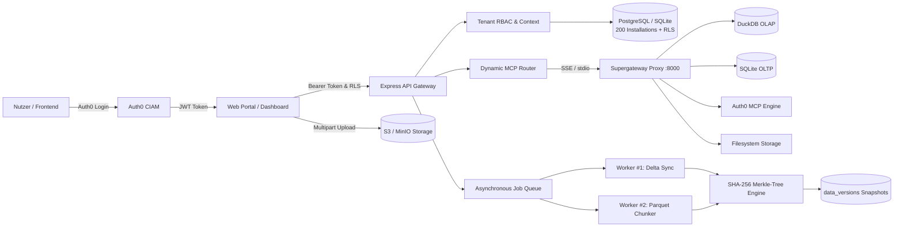

# ConnectHub MCP – Enterprise Multi-Tenant Platform

[](https://github.com/EU-UNION-AI-PACT/connecthub-mcp/actions/workflows/ci.yml)
[](LICENSE)
[](https://modelcontextprotocol.io)
[](docs/ConnectHub_Top200_Connectors.csv)
[](tests/e2e-test-suite.ts)

**ConnectHub MCP** ist eine mandantenfähige Enterprise-Plattform zur einheitlichen Anbindung von KI-Agenten und MCP-Clients an über **200 externe Datenquellen**, relationale & analytische Big-Data-Engines (DuckDB, SQLite, PostgreSQL), unterbrechungsfreie S3/MinIO Resumable Uploads und Auth0-gesicherte Identity-Flows.

---

## 🏛️ Systemarchitektur



---

## 🌟 Kernfunktionen im Überblick

| Komponente | Beschreibung | Status |
|---|---|:---:|
| **Top 200 Connectors** | Vollständig katalogisiert & aktiv in DB eingepflegt (15 Kategorien) | ✅ Aktiv |
| **Auth0 CIAM & RBAC** | Token-Verifikation, Rollen (`owner`, `admin`, `editor`, `viewer`) | ✅ Aktiv |
| **PostgreSQL RLS** | Mandantenisolation direkt auf Schema-Ebene via `current_tenant_id()` | ✅ Aktiv |
| **KMS Secret Abstraction** | Zero-Plaintext-Secrets: Speicherung ausschließlich kryptographischer KMS-URIs | ✅ Aktiv |
| **Worker Queue (BullMQ)** | Asynchrone Jobs (`sync`, `upload_process`, `connection_test`) mit Live-Progress | ✅ Aktiv |
| **Data Versioning** | Git-ähnliche SHA-256 Commit-Hashes, Records-Zähler & Parquet-Storage | ✅ Aktiv |
| **Resumable S3 Uploader** | 4-Worker-Pool, 25MB Chunks, LocalStorage-Recovery, Exponential-Backoff | ✅ Aktiv |
| **Live MCP Proxy** | Supergateway 4.2.1 auf Port 8000 mit 46 nativen Tools (DuckDB, SQLite, Storage) | ✅ Aktiv |
| **Interactive Dashboard** | Standalone HTML5-Portal mit Live-Upload-Simulator & Job-Dispatcher | ✅ Aktiv |
| **End-to-End Test Suite** | 10 automatisierte Testfälle mit Node 22 native `node:sqlite` | ✅ 10/10 PASS |

---

## 📊 Katalog der Top 200 Connectors

Alle 200 Connectors sind in [`docs/ConnectHub_Top200_Connectors.csv`](docs/ConnectHub_Top200_Connectors.csv) dokumentiert und über [`database/seed_full_installations.sql`](database/seed_full_installations.sql) in der Produktionsdatenbank vorinstalliert:

* **AI & Machine Learning (18):** OpenAI, Anthropic Claude, Hugging Face, Cohere, Mistral AI, Perplexity, Replicate, Ollama, LangChain, LlamaIndex, Together AI, Pinecone, Qdrant, ChromaDB, Weaviate, Milvus, Groq, DeepSeek.
* **Databases & OLAP (22):** PostgreSQL, MySQL, DuckDB, SQLite, Redis, MongoDB, Snowflake, Google BigQuery, Amazon Redshift, Databricks, ClickHouse, Apache Cassandra, Couchbase, Neo4j, CockroachDB, Supabase, Neon, PlanetScale, Turso, SingleStore, TiDB, TimescaleDB.
* **Cloud & Object Storage (14):** AWS S3, Google Cloud Storage, Azure Blob, MinIO, Cloudflare R2, Backblaze B2, Wasabi, Wasabi Hot Cloud, Scaleway Object Storage, DigitalOcean Spaces, Hetzner Storage Box, Dropbox, Box, Google Drive, Microsoft OneDrive.
* **DevOps, Code & CI/CD (16):** GitHub, GitLab, Bitbucket, Azure DevOps, Docker Hub, Kubernetes, Terraform Cloud, ArgoCD, Jenkins, CircleCI, Sentry, Datadog, Prometheus, Grafana, PagerDuty, New Relic.
* **Communication & Collaboration (12):** Slack, Microsoft Teams, Discord, Notion, Confluence, Jira, Linear, Asana, Monday.com, ClickUp, Trello, Basecamp.
* **CRM, Support & Marketing (20):** Salesforce, HubSpot, Zendesk, Intercom, Freshdesk, ServiceNow, Zoho CRM, Mailchimp, SendGrid, Klaviyo, Brevo, ActiveCampaign, Customer.io, Braze, Iterable, Gainsight, Gong, Salesloft, Apollo.io, Pipedrive.
* **E-Commerce, Payments & Finance (16):** Stripe, Shopify, PayPal, Square, Adyen, Plaid, QuickBooks, Xero, NetSuite, SAP S/4HANA, Chargebee, Recurly, WooCommerce, Magento, BigCommerce, Klarna.
* **Search, Vector & Analytics (14):** Elasticsearch, OpenSearch, Algolia, Meilisearch, Typesense, Mixpanel, Amplitude, PostHog, Segment, Google Analytics 4, Heap, FullStory, Logstash, Vector.
* **API & Integration Gateways (12):** Postman, Kong Gateway, Apache APISIX, Tyk, GraphQL Mesh, Apollo Federation, MuleSoft, Zapier, Make, n8n, Workato, Boomi.
* **Security & Identity (12):** Auth0, Okta, Microsoft Entra ID, HashiCorp Vault, AWS Secrets Manager, 1Password Connect, CyberArk, Ping Identity, Cloudflare Zero Trust, CrowdStrike, Snyk, SonarQube.
* **Data Pipelines & Streaming (14):** Apache Kafka, Apache Flink, Apache Spark, Apache Airflow, dbt Cloud, Prefect, Dagster, Debezium, Confluent Cloud, Redpanda, AWS Kinesis, Google Pub/Sub, Azure Event Hubs, Fivetran.
* **Content Management & Docs (12):** Strapi, Contentful, Sanity, Ghost, WordPress, ReadMe, GitBook, Docusaurus, Coda, Slite, Guru, Outline.
* **HR, Legal & Compliance (10):** Workday, BambooHR, Rippling, Personio, Gusto, DocuSign, OneTrust, Vanta, Drata, Deel.
* **Web Scraping & Extraction (8):** Firecrawl, Apify, Bright Data, Puppeteer, Playwright, Scrapy, Diffbot, ScrapingBee.

---

## 📁 Repository-Struktur

```text
connecthub-mcp/
├── .github/
│   └── workflows/ci.yml            # Automatische CI-Pipeline (Node 22 E2E Tests)
├── database/
│   ├── schema.sql                  # DDL mit nativer PostgreSQL Row Level Security (RLS)
│   ├── seed_top200_connectors.sql  # Katalog-Seed der 200 Connectors
│   ├── seed_full_installations.sql # 200 aktive Installationen + KMS + Snapshots
│   └── connecthub_production.db    # Bereitgestellte SQLite/PostgreSQL Datenbank
├── docs/
│   ├── ConnectHub_MCP_MVP_Blueprint.md      # Vollständiger Architektur-Blueprint
│   ├── ConnectHub_Top200_Connectors.csv     # Vollständiger CSV-Katalog (200 Connectors)
│   ├── ConnectHub_Top200_Catalog_Overview.md# Kategorien- & Authentifizierungs-Matrix
│   ├── ConnectHub_Top40_Connectors.csv      # Ursprüngliche 40 MVP Connectors
│   └── ConnectHub_Resumable_Upload_Client.md# Upload Client & Uppy-Adapter Dokumentation
├── gateway/
│   ├── mcp_config.json             # Supergateway Multi-Server SSE Konfiguration
│   ├── auth0-login.js              # Auth0 Device Flow & Token Persistence
│   ├── list-all-tools.js           # Tool-Aggregator für alle 46 MCP Tools
│   ├── start-gateway.sh            # Starter-Skript für Supergateway Proxy
│   └── data/                       # Relationale & analytische Datenbankdateien
├── src/
│   ├── client/
│   │   ├── ResumableS3Uploader.ts  # Autonomer Resumable S3 Uploader (Chunking, Retry)
│   │   ├── UppyS3MultipartAdapter.ts # Adapter für @uppy/aws-s3-multipart
│   │   └── useResumableUpload.ts   # React Hook für Resumable Uploads
│   ├── backend/
│   │   ├── auth.ts                 # Auth0 JWT Verifikation & Tenant RBAC
│   │   ├── dynamic-connector-router.ts # Dynamischer Dispatcher (Native & Cloud)
│   │   ├── upload-service.ts       # S3 Presigned URL & Multipart Session Manager
│   │   ├── mcp-orchestrator.ts     # MCP Protocol Stdio/SSE Client
│   │   └── api-routes.ts           # Express REST API (Zero-Dependency SQLite)
│   └── worker/
│       ├── queue.ts                # Asynchrone Event-basierte Job Queue
│       └── job-processor.ts        # Worker-Pipeline mit SHA-256 Versionierung
├── tests/
│   └── e2e-test-suite.ts           # End-to-End Test Suite (10 Testfälle)
├── web/
│   ├── connecthub_portal.html      # Komplettes Web-Dashboard mit Live-Simulatoren
│   └── mcp_dashboard.html          # MCP Proxy Control Center
├── package.json
└── README.md
```

---

## ⚡ Schnellanleitung

### 1. Abhängigkeiten installieren & Tests ausführen
```bash
# Repository klonen
git clone https://github.com/EU-UNION-AI-PACT/connecthub-mcp.git
cd connecthub-mcp

# Abhängigkeiten installieren
npm install

# End-to-End Test Suite ausführen
npm test
```

### 2. Live MCP Gateway starten (46 Native Tools)
```bash
npm run start:gateway
```
Das Gateway läuft auf `http://localhost:8000` und stellt folgende SSE-Endpunkte bereit:
* `/auth0/sse` – 23 Auth0 Security & Identity Tools
* `/duckdb/sse` – DuckDB Analytics SQL Engine
* `/sqlite/sse` – SQLite Relationale Engine
* `/storage/sse` – Dateisystem- & Storage Tools

### 3. Auth0 Browser-Login
```bash
npm run auth0:login
```
Öffnet automatisch den Browser für den Auth0 Device Code Flow und speichert die Tokens mandantenfähig in `.env` und `gateway/auth0-session.json`.

### 4. Interaktives Dashboard öffnen
Öffne `web/connecthub_portal.html` direkt im Browser (kein lokaler Build-Schritt erforderlich):
* **Tab 1 ("Katalog & 200 Aktive Installationen"):** Live-Filterung, Auth-Verfahren, Health-Checks und Latenz-Pings für alle 200 Connectoren.
* **Tab 2 ("Resumable Upload Simulator"):** Unterbrechungsfreier Multipart S3-Upload mit Pausieren, Fortsetzen und simuliertem Netzwerkausfall.
* **Tab 3 ("Daten-Versionierung & 200 Snapshots"):** Einsicht in alle kryptographischen SHA-256 Hashes und Parquet-Dateien.
* **Tab 4 ("Sync Jobs & Audit Logs"):** Interaktiver Job-Launcher zum Starten asynchroner Synchronisierungen mit Live-Fortschrittsbalken.

---

## 🔒 Mandantensicherheit & RLS-Garantien

1. **Schema-Ebene RLS:**
   ```sql
   ALTER TABLE connector_installations ENABLE ROW LEVEL SECURITY;
   CREATE POLICY tenant_isolation_installations ON connector_installations
     FOR ALL USING (tenant_id = current_tenant_id());
   ```
2. **KMS Secret Referenzierung:**
   Keine Passwörter oder API-Schlüssel in der Anwendungsdatenbank:
   ```sql
   INSERT INTO connector_secret_refs (installation_id, secret_manager_arn)
   VALUES ('i0000000-0000-0000-0000-000000000001', 'arn:aws:kms:eu-central-1:123456789012:key/openai');
   ```
3. **Kryptographische Datenversionierung:**
   Jede Synchronisation erzeugt einen unumkehrbaren SHA-256 Commit-Hash:
   ```text
   Commit: 81ee121eee5150a0f8b19a0a03b5f7...
   Storage: s3://connecthub-tenant/github/snapshots/81ee121eee51.parquet
   ```

---

## 📜 Lizenz
Apache License 2.0. Siehe [LICENSE](LICENSE) für Details.
