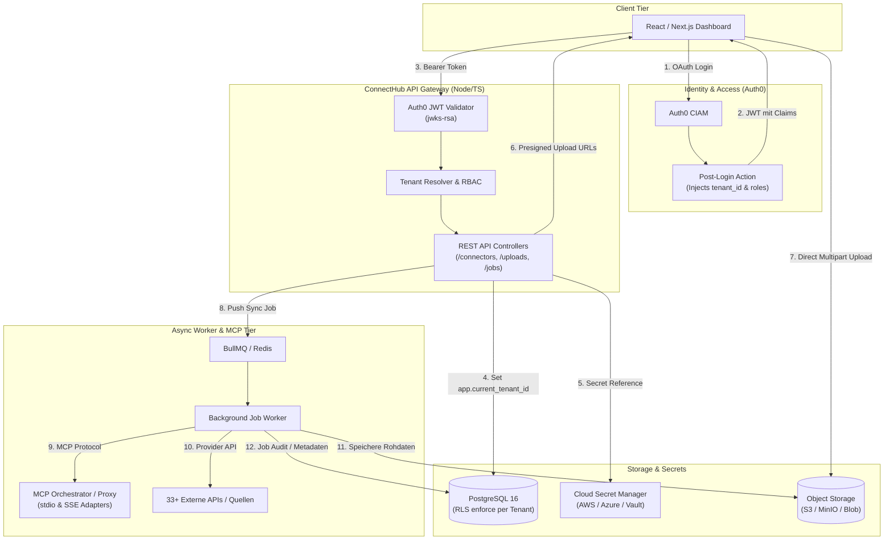
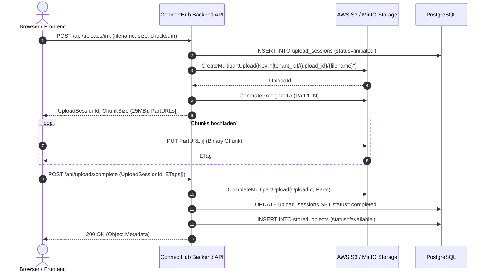

# ConnectHub MCP – Architektur- und MVP-Implementierungs-Blueprint

Dieses Dokument bildet das fundierte technische Fundament, um das PRD für **ConnectHub MCP** direkt in ein praxistaugliches, sicheres und mandantenfähiges MVP zu überführen.

---

## 1. System- & Datenfluss-Architektur



---

## 2. Auth0-Konfiguration & Custom Claims

### A. Auth0 Post-Login Action
Um den Plattformnutzer performant ohne zusätzliche Datenbank-Roundtrips an einen Mandanten zu binden, wird in Auth0 eine **Post-Login Action** hinterlegt:

```javascript
exports.onExecutePostLogin = async (event, api) => {
  const namespace = 'https://connecthub.io/claims';
  
  // Ermittle Tenant & Rolle aus Auth0 App-Metadata oder externer Tabelle
  const tenantId = event.user.app_metadata?.tenant_id || 'tenant_default_uuid';
  const role = event.user.app_metadata?.role || 'editor';

  api.idToken.setCustomClaim(`${namespace}/tenant_id`, tenantId);
  api.idToken.setCustomClaim(`${namespace}/role`, role);
  
  api.accessToken.setCustomClaim(`${namespace}/tenant_id`, tenantId);
  api.accessToken.setCustomClaim(`${namespace}/role`, role);
};
```

---

## 3. PostgreSQL mit nativer Row-Level-Security (RLS)

Um versehentliche Datenlecks zwischen Mandanten im Code auf Datenbankebene unmöglich zu machen, erzwingt PostgreSQL Row-Level-Security:

```sql
-- 1. RLS Helper-Funktion
CREATE OR REPLACE FUNCTION current_tenant_id() RETURNS UUID AS $$
  SELECT NULLIF(current_setting('app.current_tenant_id', true), '')::UUID;
$$ LANGUAGE sql STABLE;

-- 2. RLS auf Mandantentabellen aktivieren
ALTER TABLE connector_installations ENABLE ROW LEVEL SECURITY;
ALTER TABLE connector_secret_refs ENABLE ROW LEVEL SECURITY;
ALTER TABLE jobs ENABLE ROW LEVEL SECURITY;
ALTER TABLE upload_sessions ENABLE ROW LEVEL SECURITY;
ALTER TABLE stored_objects ENABLE ROW LEVEL SECURITY;
ALTER TABLE audit_events ENABLE ROW LEVEL SECURITY;

-- 3. Tenant-Isolation Policies anlegen
CREATE POLICY tenant_isolation_installations ON connector_installations
  FOR ALL
  USING (tenant_id = current_tenant_id())
  WITH CHECK (tenant_id = current_tenant_id());

CREATE POLICY tenant_isolation_jobs ON jobs
  FOR ALL
  USING (tenant_id = current_tenant_id())
  WITH CHECK (tenant_id = current_tenant_id());

CREATE POLICY tenant_isolation_stored_objects ON stored_objects
  FOR ALL
  USING (tenant_id = current_tenant_id())
  WITH CHECK (tenant_id = current_tenant_id());

-- 4. Session Context Setzen bei jeder DB-Transaktion:
-- SET LOCAL app.current_tenant_id = 'c4b8e219-583b-4171-893d-d4a9ec891c33';
```

---

## 4. Secret Manager Envelope Pattern

> [!CAUTION]
> Zugangsdaten, API-Tokens und SSH-Keys dürfen **niemals** im Klartext oder mit statischen Keys in `connector_installations.configuration` abgelegt werden.

### Schema der Secret-Referenzierung
1. Die Frontend-App sendet Zugangsdaten bei der Connector-Erstellung über TLS an `/api/connectors/:id/credentials`.
2. Das Backend speichert die Zugangsdaten im **Cloud Secret Manager** (oder HashiCorp Vault) unter dem Pfad:  
   `connecthub/{tenant_id}/connectors/{installation_id}/creds`
3. In PostgreSQL wird lediglich die URI abgelegt:
   ```json
   {
     "secret_provider": "aws_secrets_manager",
     "secret_ref": "arn:aws:secretsmanager:eu-central-1:123456789:secret:connecthub/t-123/conn-456",
     "secret_version": "AWSCURRENT"
   }
   ```
4. Nur autorisierte Worker-Jobs dürfen die Secrets temporär im Speicher entschlüsseln.

---

## 5. Resumable Multipart Upload Architektur (Object Storage)

Für Gigabyte- und Terabyte-Dateien läuft der Datenstrom nicht über die Backend-Container, sondern direkt vom Browser in den Object Storage (S3 / MinIO):



---

## 6. Vollständige TypeScript MVP-Implementierungsvorlage

### Modul A: Auth0 & Tenant Context Middleware (`src/middleware/auth.ts`)

```typescript
import { Request, Response, NextFunction } from 'express';
import { expressjwt as jwt } from 'express-jwt';
import jwksRsa from 'jwks-rsa';

export interface AuthenticatedUser {
  sub: string;
  tenant_id: string;
  role: 'owner' | 'admin' | 'editor' | 'viewer';
}

declare global {
  namespace Express {
    interface Request {
      user?: AuthenticatedUser;
    }
  }
}

const AUTH0_DOMAIN = process.env.AUTH0_DOMAIN || 'auth0.auth0.com';
const AUTH0_AUDIENCE = process.env.AUTH0_AUDIENCE || 'https://api.connecthub.io';
const CLAIM_NS = 'https://connecthub.io/claims';

export const checkJwt = jwt({
  secret: jwksRsa.expressJwtSecret({
    cache: true,
    rateLimit: true,
    jwksRequestsPerMinute: 10,
    jwksUri: `https://${AUTH0_DOMAIN}/.well-known/jwks.json`
  }) as any,
  audience: AUTH0_AUDIENCE,
  issuer: `https://${AUTH0_DOMAIN}/`,
  algorithms: ['RS256']
});

export const resolveTenantContext = (req: Request, res: Response, next: NextFunction) => {
  const tokenPayload = (req as any).auth;
  if (!tokenPayload) {
    return res.status(401).json({ error: 'Unauthorized: Missing token' });
  }

  req.user = {
    sub: tokenPayload.sub,
    tenant_id: tokenPayload[`${CLAIM_NS}/tenant_id`] || req.headers['x-tenant-id'] || 'default_tenant',
    role: tokenPayload[`${CLAIM_NS}/role`] || 'viewer'
  };

  next();
};

export const requireRole = (allowedRoles: string[]) => {
  return (req: Request, res: Response, next: NextFunction) => {
    if (!req.user || !allowedRoles.includes(req.user.role)) {
      return res.status(403).json({ error: 'Forbidden: Insufficient tenant permissions' });
    }
    next();
  };
};
```

---

### Modul B: MCP Orchestrator Adapter (`src/services/mcp-orchestrator.ts`)

```typescript
import { spawn } from 'child_process';
import readline from 'readline';

export interface McpToolCallResult {
  tool: string;
  output: any;
  durationMs: number;
}

export class McpOrchestrator {
  /**
   * Führt einen MCP-Tool-Call über Stdio gegen einen Provider-Server aus
   */
  public static async executeTool(
    command: string,
    args: string[],
    toolName: string,
    toolArgs: Record<string, any>,
    env: Record<string, string> = {}
  ): Promise<McpToolCallResult> {
    const startTime = Date.now();

    return new Promise((resolve, reject) => {
      const proc = spawn(command, args, {
        stdio: ['pipe', 'pipe', 'pipe'],
        env: { ...process.env, ...env }
      });

      const rl = readline.createInterface({ input: proc.stdout });
      let callResult: any = null;

      // 1. Initialisierung
      const initMessage = {
        jsonrpc: '2.0',
        id: 1,
        method: 'initialize',
        params: {
          protocolVersion: '2024-11-05',
          capabilities: {},
          clientInfo: { name: 'connecthub-orchestrator', version: '1.0.0' }
        }
      };
      proc.stdin.write(JSON.stringify(initMessage) + '\n');

      rl.on('line', (line) => {
        try {
          const msg = JSON.parse(line);
          if (msg.id === 1) {
            // Initialized Notification
            proc.stdin.write(JSON.stringify({ jsonrpc: '2.0', method: 'notifications/initialized', params: {} }) + '\n');
            // Tool-Call absenden
            const toolCallReq = {
              jsonrpc: '2.0',
              id: 2,
              method: 'tools/call',
              params: {
                name: toolName,
                arguments: toolArgs
              }
            };
            proc.stdin.write(JSON.stringify(toolCallReq) + '\n');
          } else if (msg.id === 2) {
            callResult = msg.result;
            proc.kill();
            resolve({
              tool: toolName,
              output: callResult,
              durationMs: Date.now() - startTime
            });
          }
        } catch (e) {
          // ignore stream noise
        }
      });

      proc.on('error', (err) => reject(err));
      
      setTimeout(() => {
        proc.kill();
        reject(new Error(`MCP Tool ${toolName} execution timed out (30s)`));
      }, 30000);
    });
  }
}
```

---

### Modul C: S3 Resumable Upload Service (`src/services/upload-service.ts`)

```typescript
import { S3Client, CreateMultipartUploadCommand, UploadPartCommand, CompleteMultipartUploadCommand } from '@aws-sdk/client-s3';
import { getSignedUrl } from '@aws-sdk/s3-request-presigner';

const s3 = new S3Client({
  region: process.env.AWS_REGION || 'eu-central-1',
  endpoint: process.env.S3_ENDPOINT // optional für MinIO
});

const BUCKET_NAME = process.env.S3_BUCKET || 'connecthub-tenant-storage';
const PART_SIZE = 25 * 1024 * 1024; // 25 MB Chunks

export class UploadService {
  public static async initUpload(tenantId: string, filename: string, sizeBytes: number) {
    const objectKey = `${tenantId}/uploads/${Date.now()}_${filename}`;

    const createRes = await s3.send(new CreateMultipartUploadCommand({
      Bucket: BUCKET_NAME,
      Key: objectKey,
      Metadata: { tenant_id: tenantId, original_filename: filename }
    }));

    const uploadId = createRes.UploadId!;
    const totalParts = Math.ceil(sizeBytes / PART_SIZE);
    const presignedUrls: { partNumber: number; url: string }[] = [];

    // Generiere URLs für alle Parts
    for (let partNumber = 1; partNumber <= totalParts; partNumber++) {
      const url = await getSignedUrl(s3, new UploadPartCommand({
        Bucket: BUCKET_NAME,
        Key: objectKey,
        UploadId: uploadId,
        PartNumber: partNumber
      }), { expiresIn: 3600 });

      presignedUrls.push({ partNumber, url });
    }

    return {
      objectKey,
      uploadId,
      partSize: PART_SIZE,
      totalParts,
      presignedUrls
    };
  }

  public static async completeUpload(
    objectKey: string,
    uploadId: string,
    parts: { PartNumber: number; ETag: string }[]
  ) {
    return s3.send(new CompleteMultipartUploadCommand({
      Bucket: BUCKET_NAME,
      Key: objectKey,
      UploadId: uploadId,
      MultipartUpload: {
        Parts: parts.sort((a, b) => a.PartNumber - b.PartNumber)
      }
    }));
  }
}
```

---

### Modul D: Core REST API Controller (`src/routes/api.ts`)

```typescript
import { Router } from 'express';
import { checkJwt, resolveTenantContext, requireRole } from '../middleware/auth';
import { UploadService } from '../services/upload-service';
import { McpOrchestrator } from '../services/mcp-orchestrator';

const router = Router();

// Globale Auth0 & Tenant Pipeline
router.use(checkJwt, resolveTenantContext);

// 1. Connector Katalog abfragen
router.get('/connectors/catalog', async (req, res) => {
  // DB Query: SELECT * FROM connector_catalog WHERE is_enabled = true
  res.json({ status: 'success', tenant: req.user!.tenant_id, count: 40 });
});

// 2. Verbindung testen
router.post('/connectors/:id/test', requireRole(['owner', 'admin', 'editor']), async (req, res) => {
  try {
    // Führe Health-Check oder Test-Tool über MCP aus
    const result = await McpOrchestrator.executeTool(
      'uvx',
      ['--with', 'mcp<1.2.0', 'mcp-server-sqlite', '--db-path', '/tmp/test.db'],
      'list_tables',
      {}
    );
    res.json({ status: 'connected', result });
  } catch (err: any) {
    res.status(500).json({ status: 'failed', error: err.message });
  }
});

// 3. Resumable Upload initialisieren
router.post('/uploads/init', requireRole(['owner', 'admin', 'editor']), async (req, res) => {
  const { filename, sizeBytes } = req.body;
  const session = await UploadService.initUpload(req.user!.tenant_id, filename, sizeBytes);
  res.json(session);
});

// 4. Resumable Upload abschließen
router.post('/uploads/complete', requireRole(['owner', 'admin', 'editor']), async (req, res) => {
  const { objectKey, uploadId, parts } = req.body;
  await UploadService.completeUpload(objectKey, uploadId, parts);
  res.json({ status: 'available', objectKey });
});

export default router;
```

---

## 7. Produktions-Checkliste & Härtungs-Roadmap

1. **Auth0 Scope Enforcement**: API-Endpunkte granular nach Scopes (`read:connectors`, `write:connectors`, `upload:data`) via Auth0 absichern.
2. **KMS Envelope Encryption**: Secret-Tokens mit Cloud KMS vor dem Schreiben in den Secret Manager zusätzlich applikatorisch verschlüsseln.
3. **Storage Retention Worker**: Cronjob zur Durchsetzung von Löschfristen (`retention_until`) und automatischem Cleanup abgebrochener S3-Uploads (`AbortIncompleteMultipartUpload`).
4. **Tenant Storage Quota**: Vor dem Ausstellen von `UploadPart`-URLs prüfen, ob `SUM(size_bytes) + expected_size <= storage_quota_bytes`.
