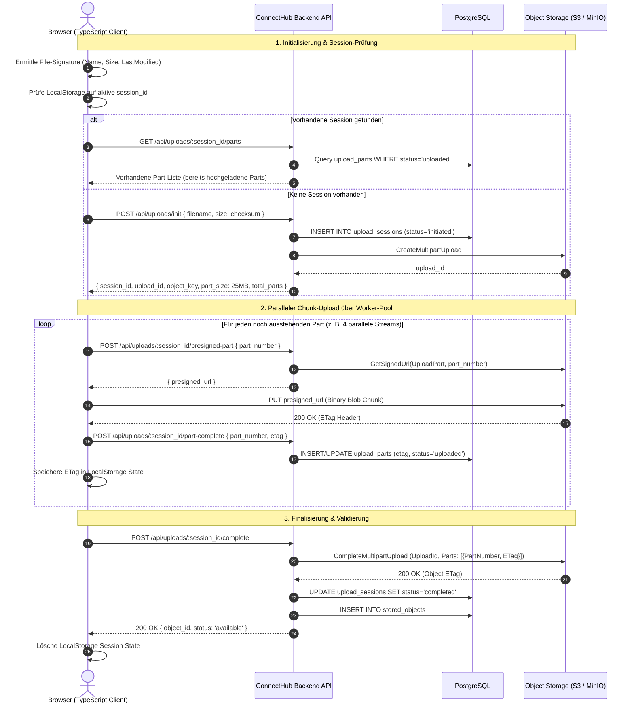

# ConnectHub MCP – Resumable Multipart Upload Client (S3 & MinIO)

Dieser Client ermöglicht zuverlässige Direct-to-Storage-Uploads für Gigabyte- und Terabyte-Dateien direkt aus dem Browser in AWS S3, Google Cloud Storage oder MinIO — unterbrechungssicher, pausierbar und mit automatischer Wiederaufnahme.

---

## 1. Upload-Architektur & Wiederaufnahme-Protokoll



---

## 2. Core Resumable S3 Uploader (`ResumableS3Uploader.ts`)

Ein eigenständiger TypeScript-Client ohne schwere externe Abhängigkeiten mit:
- Dynamischer Parallelität (Concurrency Pool, standardmäßig 4 Chunks gleichzeitig)
- Pause-, Resume- und Abort-Kontrolle
- Automatischem Exponential-Backoff bei Netzwerkabbrüchen
- Persistenz des Übertragungsfortschritts im Browser

```typescript
export interface UploadOptions {
  apiBaseUrl: string;
  authToken: string;
  tenantId: string;
  partSize?: number; // Standard: 25 MB
  concurrency?: number; // Standard: 4 parallele Uploads
  maxRetries?: number; // Standard: 5 Versuche pro Chunk
  onProgress?: (progress: UploadProgress) => void;
  onError?: (error: Error) => void;
  onSuccess?: (result: UploadCompleteResult) => void;
}

export interface UploadProgress {
  bytesUploaded: number;
  totalBytes: number;
  percentage: number;
  activeParts: number[];
  completedParts: number;
  totalParts: number;
  speedBytesPerSec: number;
}

export interface UploadCompleteResult {
  sessionId: string;
  objectKey: string;
  checksum: string;
}

interface StoredSessionState {
  sessionId: string;
  uploadId: string;
  objectKey: string;
  fileSignature: string;
  partSize: number;
  totalParts: number;
  completedParts: { partNumber: number; etag: string }[];
}

export class ResumableS3Uploader {
  private file: File;
  private options: Required<UploadOptions>;
  private isPaused: boolean = false;
  private isAborted: boolean = false;
  private activeControllers: Map<number, AbortController> = new Map();
  private state!: StoredSessionState;
  private lastProgressTime: number = Date.now();
  private lastProgressBytes: number = 0;

  constructor(file: File, options: UploadOptions) {
    this.file = file;
    this.options = {
      partSize: 25 * 1024 * 1024, // 25 MB
      concurrency: 4,
      maxRetries: 5,
      onProgress: () => {},
      onError: () => {},
      onSuccess: () => {},
      ...options
    };
  }

  private get fileSignature(): string {
    return `${this.file.name}_${this.file.size}_${this.file.lastModified}`;
  }

  private get storageKey(): string {
    return `connecthub_upload_${this.options.tenantId}_${this.fileSignature}`;
  }

  public async start(): Promise<void> {
    this.isPaused = false;
    this.isAborted = false;

    try {
      // 1. Prüfe auf wiederaufnehmbare Session
      await this.initOrResumeSession();

      // 2. Ermittle noch ausstehende Parts
      const completedSet = new Set(this.state.completedParts.map((p) => p.partNumber));
      const pendingParts: number[] = [];

      for (let i = 1; i <= this.state.totalParts; i++) {
        if (!completedSet.has(i)) {
          pendingParts.push(i);
        }
      }

      if (pendingParts.length === 0) {
        await this.finalizeUpload();
        return;
      }

      // 3. Starte Concurrency Worker Pool
      await this.runWorkerPool(pendingParts);

      // 4. Prüfe nach Abarbeitung
      if (!this.isPaused && !this.isAborted) {
        await this.finalizeUpload();
      }
    } catch (err: any) {
      if (!this.isPaused && !this.isAborted) {
        this.options.onError(err);
      }
    }
  }

  public pause(): void {
    this.isPaused = true;
    for (const controller of this.activeControllers.values()) {
      controller.abort();
    }
    this.activeControllers.clear();
  }

  public async abort(): Promise<void> {
    this.isAborted = true;
    this.pause();

    try {
      if (this.state?.sessionId) {
        await fetch(`${this.options.apiBaseUrl}/uploads/${this.state.sessionId}/abort`, {
          method: 'POST',
          headers: this.authHeaders()
        });
      }
    } finally {
      localStorage.removeItem(this.storageKey);
    }
  }

  private async initOrResumeSession(): Promise<void> {
    const rawState = localStorage.getItem(this.storageKey);

    if (rawState) {
      try {
        const parsed: StoredSessionState = JSON.parse(rawState);
        // Validiere Session mit Backend
        const res = await fetch(`${this.options.apiBaseUrl}/uploads/${parsed.sessionId}/status`, {
          headers: this.authHeaders()
        });

        if (res.ok) {
          const remoteStatus = await res.json();
          if (remoteStatus.status === 'uploading' || remoteStatus.status === 'initiated') {
            this.state = {
              ...parsed,
              completedParts: remoteStatus.parts || parsed.completedParts
            };
            return;
          }
        }
      } catch (e) {
        // Fallback: Neue Session anlegen
      }
    }

    // Neue Session über Backend initiieren
    const totalParts = Math.ceil(this.file.size / this.options.partSize);
    const res = await fetch(`${this.options.apiBaseUrl}/uploads/init`, {
      method: 'POST',
      headers: { ...this.authHeaders(), 'Content-Type': 'application/json' },
      body: JSON.stringify({
        filename: this.file.name,
        sizeBytes: this.file.size,
        contentType: this.file.type || 'application/octet-stream',
        partSize: this.options.partSize,
        totalParts
      })
    });

    if (!res.ok) {
      throw new Error(`Init Upload failed with status ${res.status}`);
    }

    const data = await res.json();
    this.state = {
      sessionId: data.sessionId,
      uploadId: data.uploadId,
      objectKey: data.objectKey,
      fileSignature: this.fileSignature,
      partSize: this.options.partSize,
      totalParts,
      completedParts: []
    };

    this.saveState();
  }

  private async runWorkerPool(pendingParts: number[]): Promise<void> {
    const queue = [...pendingParts];
    const workers: Promise<void>[] = [];

    const worker = async (): Promise<void> => {
      while (queue.length > 0 && !this.isPaused && !this.isAborted) {
        const partNumber = queue.shift()!;
        await this.uploadPartWithRetry(partNumber);
      }
    };

    const workerCount = Math.min(this.options.concurrency, queue.length);
    for (let i = 0; i < workerCount; i++) {
      workers.push(worker());
    }

    await Promise.all(workers);
  }

  private async uploadPartWithRetry(partNumber: number): Promise<void> {
    let attempt = 0;

    while (attempt < this.options.maxRetries && !this.isPaused && !this.isAborted) {
      attempt++;
      try {
        const controller = new AbortController();
        this.activeControllers.set(partNumber, controller);

        // 1. Hole frische Presigned Part URL vom Backend
        const presignedUrl = await this.getPresignedPartUrl(partNumber);

        // 2. Extrahiere Slice aus File
        const start = (partNumber - 1) * this.state.partSize;
        const end = Math.min(start + this.state.partSize, this.file.size);
        const chunk = this.file.slice(start, end);

        // 3. Sende Binary PUT direkt an S3 / MinIO
        const s3Res = await fetch(presignedUrl, {
          method: 'PUT',
          body: chunk,
          signal: controller.signal
        });

        if (!s3Res.ok) {
          throw new Error(`S3 Part Upload ${partNumber} failed: ${s3Res.status}`);
        }

        const rawEtag = s3Res.headers.get('ETag') || s3Res.headers.get('etag');
        if (!rawEtag) {
          throw new Error(`Missing ETag header on Part ${partNumber}`);
        }
        const etag = rawEtag.replace(/"/g, ''); // Quotes strippen

        // 4. Melde ETag an Backend
        await this.reportPartComplete(partNumber, etag, end - start);

        // 5. State aktualisieren
        this.state.completedParts.push({ partNumber, etag });
        this.saveState();
        this.activeControllers.delete(partNumber);

        this.notifyProgress();
        return;
      } catch (err: any) {
        this.activeControllers.delete(partNumber);
        if (this.isPaused || this.isAborted) return;

        if (attempt >= this.options.maxRetries) {
          throw new Error(`Part ${partNumber} failed after ${attempt} retries: ${err.message}`);
        }

        // Exponential Backoff (250ms, 500ms, 1000ms, ...)
        const backoffMs = Math.pow(2, attempt) * 250 + Math.random() * 100;
        await new Promise((r) => setTimeout(r, backoffMs));
      }
    }
  }

  private async getPresignedPartUrl(partNumber: number): Promise<string> {
    const res = await fetch(
      `${this.options.apiBaseUrl}/uploads/${this.state.sessionId}/part-url?partNumber=${partNumber}`,
      { headers: this.authHeaders() }
    );
    if (!res.ok) throw new Error(`Could not get Part URL for part ${partNumber}`);
    const data = await res.json();
    return data.presignedUrl;
  }

  private async reportPartComplete(partNumber: number, etag: string, sizeBytes: number): Promise<void> {
    await fetch(`${this.options.apiBaseUrl}/uploads/${this.state.sessionId}/part-complete`, {
      method: 'POST',
      headers: { ...this.authHeaders(), 'Content-Type': 'application/json' },
      body: JSON.stringify({ partNumber, etag, sizeBytes })
    });
  }

  private async finalizeUpload(): Promise<void> {
    const res = await fetch(`${this.options.apiBaseUrl}/uploads/${this.state.sessionId}/complete`, {
      method: 'POST',
      headers: { ...this.authHeaders(), 'Content-Type': 'application/json' },
      body: JSON.stringify({
        parts: this.state.completedParts
      })
    });

    if (!res.ok) {
      throw new Error(`Complete upload failed with status ${res.status}`);
    }

    const data = await res.json();
    localStorage.removeItem(this.storageKey);

    this.options.onSuccess({
      sessionId: this.state.sessionId,
      objectKey: this.state.objectKey,
      checksum: data.checksum
    });
  }

  private notifyProgress(): void {
    const completedCount = this.state.completedParts.length;
    let bytesUploaded = 0;

    for (const p of this.state.completedParts) {
      const start = (p.partNumber - 1) * this.state.partSize;
      const end = Math.min(start + this.state.partSize, this.file.size);
      bytesUploaded += end - start;
    }

    const now = Date.now();
    const timeDeltaSec = (now - this.lastProgressTime) / 1000;
    let speed = 0;
    if (timeDeltaSec > 0.5) {
      speed = (bytesUploaded - this.lastProgressBytes) / timeDeltaSec;
      this.lastProgressTime = now;
      this.lastProgressBytes = bytesUploaded;
    }

    this.options.onProgress({
      bytesUploaded,
      totalBytes: this.file.size,
      percentage: Math.round((bytesUploaded / this.file.size) * 100),
      activeParts: Array.from(this.activeControllers.keys()),
      completedParts: completedCount,
      totalParts: this.state.totalParts,
      speedBytesPerSec: speed
    });
  }

  private saveState(): void {
    localStorage.setItem(this.storageKey, JSON.stringify(this.state));
  }

  private authHeaders(): Record<string, string> {
    return {
      Authorization: `Bearer ${this.options.authToken}`,
      'X-Tenant-ID': this.options.tenantId
    };
  }
}
```

---

## 3. Uppy-Plugin Adapter (`UppyS3MultipartAdapter.ts`)

Für Teams, die fertige UI-Komponenten wie das Dashboard von `@uppy/react` oder Tus verwenden möchten, lässt sich der Uploader nahtlos als `@uppy/aws-s3-multipart` Plugin einhängen:

```typescript
import Uppy from '@uppy/core';
import AwsS3Multipart from '@uppy/aws-s3-multipart';

export function configureConnectHubUppy(
  uppy: Uppy,
  apiBaseUrl: string,
  authToken: string,
  tenantId: string
) {
  uppy.use(AwsS3Multipart, {
    limit: 4, // 4 parallele Chunks
    retryDelays: [0, 1000, 3000, 5000],
    
    // 1. Session initialisieren
    async createMultipartUpload(file) {
      const res = await fetch(`${apiBaseUrl}/uploads/init`, {
        method: 'POST',
        headers: {
          Authorization: `Bearer ${authToken}`,
          'X-Tenant-ID': tenantId,
          'Content-Type': 'application/json'
        },
        body: JSON.stringify({
          filename: file.name,
          sizeBytes: file.size,
          contentType: file.type
        })
      });
      const data = await res.json();
      return {
        uploadId: data.uploadId,
        key: data.objectKey
      };
    },

    // 2. Presigned Part-URL abrufen
    async signPart(file, partData) {
      const { uploadId, key, partNumber } = partData;
      const res = await fetch(
        `${apiBaseUrl}/uploads/sign-part?key=${encodeURIComponent(key)}&uploadId=${uploadId}&partNumber=${partNumber}`,
        {
          headers: {
            Authorization: `Bearer ${authToken}`,
            'X-Tenant-ID': tenantId
          }
        }
      );
      const data = await res.json();
      return { url: data.presignedUrl };
    },

    // 3. Upload finalisieren
    async completeMultipartUpload(file, { uploadId, key, parts }) {
      const res = await fetch(`${apiBaseUrl}/uploads/complete`, {
        method: 'POST',
        headers: {
          Authorization: `Bearer ${authToken}`,
          'X-Tenant-ID': tenantId,
          'Content-Type': 'application/json'
        },
        body: JSON.stringify({ uploadId, objectKey: key, parts })
      });
      const data = await res.json();
      return { location: data.location };
    },

    // 4. Abbrechen
    async abortMultipartUpload(file, { uploadId, key }) {
      await fetch(`${apiBaseUrl}/uploads/abort`, {
        method: 'POST',
        headers: {
          Authorization: `Bearer ${authToken}`,
          'X-Tenant-ID': tenantId,
          'Content-Type': 'application/json'
        },
        body: JSON.stringify({ uploadId, objectKey: key })
      });
    }
  });
}
```

---

## 4. React Hook (`useResumableUpload.ts`)

```typescript
import { useState, useRef, useCallback } from 'react';
import { ResumableS3Uploader, UploadProgress } from './ResumableS3Uploader';

export function useResumableUpload(apiBaseUrl: string, authToken: string, tenantId: string) {
  const [progress, setProgress] = useState<UploadProgress | null>(null);
  const [status, setStatus] = useState<'idle' | 'uploading' | 'paused' | 'completed' | 'error'>('idle');
  const [error, setError] = useState<string | null>(null);
  const uploaderRef = useRef<ResumableS3Uploader | null>(null);

  const startUpload = useCallback((file: File) => {
    setStatus('uploading');
    setError(null);

    const uploader = new ResumableS3Uploader(file, {
      apiBaseUrl,
      authToken,
      tenantId,
      onProgress: (p) => setProgress(p),
      onSuccess: () => setStatus('completed'),
      onError: (err) => {
        setStatus('error');
        setError(err.message);
      }
    });

    uploaderRef.current = uploader;
    uploader.start();
  }, [apiBaseUrl, authToken, tenantId]);

  const pauseUpload = useCallback(() => {
    if (uploaderRef.current) {
      uploaderRef.current.pause();
      setStatus('paused');
    }
  }, []);

  const resumeUpload = useCallback(() => {
    if (uploaderRef.current) {
      setStatus('uploading');
      uploaderRef.current.start();
    }
  }, []);

  const abortUpload = useCallback(() => {
    if (uploaderRef.current) {
      uploaderRef.current.abort();
      setStatus('idle');
      setProgress(null);
    }
  }, []);

  return {
    startUpload,
    pauseUpload,
    resumeUpload,
    abortUpload,
    progress,
    status,
    error
  };
}
```

---

## 5. Backend S3 CORS-Konfiguration

Damit Browser direkte `PUT`-Requests für Chunks an S3/MinIO senden und `ETag`-Header lesen können, muss das Bucket folgende CORS-Regel aufweisen:

```json
[
  {
    "AllowedHeaders": ["*"],
    "AllowedMethods": ["PUT", "POST", "GET", "HEAD"],
    "AllowedOrigins": ["https://app.connecthub.io", "http://localhost:3000"],
    "ExposeHeaders": ["ETag"],
    "MaxAgeSeconds": 3600
  }
]
```
